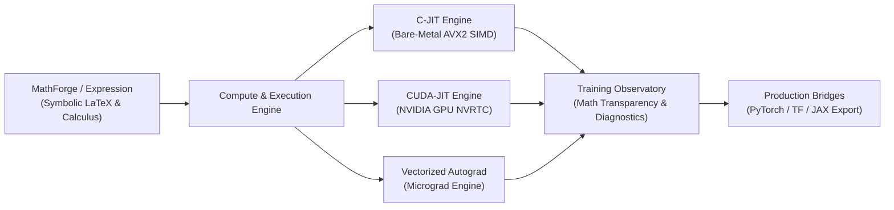

<p align="center">
  <a href="https://github.com/fahiiim/NeuroGebra">
    
  </a>
</p>

<h2 align="center">The Executable Mathematical Foundation for AI & Scientific Computing</h2>

<p align="center">
  <strong>Bridging symbolic rigor, real-time math transparency, and bare-metal C++ / CUDA GPU hardware acceleration.</strong>
</p>

<p align="center">
  <em>Trusted by over 10,000+ researchers, educators, and engineers worldwide.</em>
</p>

<p align="center">
  <!-- Package & Ecosystem -->
  <a href="https://pypi.org/project/neurogebra/"></a>
  <a href="https://pypi.org/project/neurogebra/"></a>
  <a href="https://pepy.tech/project/neurogebra"></a>
  <a href="https://pepy.tech/project/neurogebra"></a>
</p>

<p align="center">
  <!-- Quality & Documentation -->
  <a href="https://github.com/fahiiim/NeuroGebra/actions/workflows/tests.yml"></a>
  <a href="https://codecov.io/gh/fahiiim/NeuroGebra"></a>
  <a href="https://neurogebra.readthedocs.io/"></a>
  <a href="https://github.com/fahiiim/NeuroGebra/blob/main/LICENSE"></a>
</p>

<p align="center">
  <a href="#the-legacy-of-neurogebra">The Legacy</a> &bull;
  <a href="#why-neurogebra">Why NeuroGebra?</a> &bull;
  <a href="#installation">Installation</a> &bull;
  <a href="#quick-start">Quick Start</a> &bull;
  <a href="#hardware-acceleration">Hardware Acceleration</a> &bull;
  <a href="#training-observatory">Observatory</a> &bull;
  <a href="#colab-projects">10 Colab Projects</a> &bull;
  <a href="https://neurogebra.readthedocs.io">Documentation</a>
</p>

<p align="center">
  <a href="https://clickhouse-analytics.metabaseapp.com/public/dashboard/365e0045-2935-4fe3-a66f-4f8059261dc4?project_name=neurogebra#&theme=night">
    
  </a>
</p>

---

## The Legacy of NeuroGebra

> *"Modern machine learning has become extraordinarily powerful, but in the race for scale, it became an opaque black box. Practitioners call `loss.backward()` without seeing the calculus, and students memorize API calls without understanding the algebraic derivations underneath."*

**NeuroGebra was founded to solve this divide.**

Conceived as a union of **symbolic mathematics (SymPy)**, **numerical computing (NumPy)**, and **real-time diagnostic observability**, NeuroGebra began as a curated mathematical formula companion designed to make the mathematics of artificial intelligence tangible, searchable, and executable.

Over successive releases, NeuroGebra has evolved into an international open-source standard:
- 🌍 **10,000+ Practitioners Worldwide:** Adopted by university courses, researchers experimenting with novel architectures, and ML engineers auditing mathematical divergence.
- 📐 **100+ Curated Mathematical Expressions:** Covering 10 domains from activation manifolds and non-convex loss functions to attention mechanisms, probability metrics, and optimization dynamics.
- 🔬 **The First Mathematical Training Observatory:** Bringing live algebraic formulas, weight distribution telemetry, vanishing gradient alarms, and reproducible training fingerprints directly into your terminal.
- ⚡ **Native Hardware JIT Acceleration (v2.6+):** Bridging the educational clarity of symbolic math with bare-metal **C++ AVX2 SIMD** and **NVIDIA CUDA GPU execution**, outperforming baseline NumPy by up to **4.76x**.

NeuroGebra stands today not merely as a library, but as a commitment: **that high-performance artificial intelligence should never require abandoning mathematical understanding.**

---

## Why NeuroGebra?

Most deep learning frameworks ask you to choose between **interpretability** and **performance**. NeuroGebra provides a unified paradigm where every expression is simultaneously:
1. **Symbolic:** Render exact LaTeX formulas, compute analytical derivatives, and introspect algebraic structures via SymPy.
2. **Numerical:** Evaluate vectors and tensors with high-speed NumPy vectorized pipelines.
3. **Hardware-Accelerated:** Compile on-the-fly into native C++ SIMD or NVIDIA CUDA C kernels via NVRTC with zero external build configuration.
4. **Trainable:** Bind learnable weights and optimize parameters with built-in Adam, SGD, and real backpropagation.
5. **Self-Explaining:** Every formula, layer, and training warning features an embedded `.explain()` method.



### Framework Comparison

| Capability | NeuroGebra | PyTorch / TensorFlow | SymPy | Pure NumPy |
| :--- | :---: | :---: | :---: | :---: |
| **Searchable ML Formula Repository** | **Yes (10 Domains)** | No | No | No |
| **Symbolic Math & Analytical Gradients** | **Yes** | No | Yes | No |
| **Live Formula Math Transparency in Training** | **Yes (Observatory)** | No | No | No |
| **Automated Health Warnings (Dead ReLU, Divergence)** | **Yes (Pro Rules)** | No | No | No |
| **Reproducibility Fingerprinting (Hardware/Dataset Hash)** | **Yes** | Manual | No | No |
| **On-the-Fly C-JIT & CUDA GPU Compilation** | **Yes** | Pre-compiled | No | No |
| **Export to Production (PyTorch, TF, JAX)** | **Yes** | Native | No | No |
| **Zero-Setup Educational Explainability** | **Yes (`.explain()`)** | No | Partial | No |

---

## Installation

Install NeuroGebra in seconds from PyPI:

```bash
pip install neurogebra
```

### Optional Extras for Advanced Workflows

```bash
pip install "neurogebra[viz]"          # Interactive Visualization (Plotly, Seaborn)
pip install "neurogebra[frameworks]"   # Framework Bridges (PyTorch, TensorFlow)
pip install "neurogebra[logging]"      # TensorBoard & Weights & Biases telemetry
pip install "neurogebra[datasets]"     # Real-world dataset integrations
pip install "neurogebra[all]"          # Complete ecosystem bundle
```

**System Requirements:** Python 3.9+ | Linux, macOS (Intel & Apple Silicon), Windows | CUDA 11.0+ (optional for GPU).

---

## Quick Start

### 1. Discover and Evaluate AI Formulas in 30 Seconds

```python
from neurogebra import MathForge

forge = MathForge()

# Retrieve curated expressions across 10 domains
gelu = forge.get("gelu")
print(gelu.formula)    # LaTeX: 0.5 \cdot x \cdot \left(1 + \text{erf}\left(\frac{x}{\sqrt{2}}\right)\right)
print(gelu.explain())  # Comprehensive educational breakdown & practical guidelines
print(gelu.eval(x=1.5)) # Evaluated numerical result: 1.399...

# Compute exact analytical derivatives
gelu_derivative = gelu.gradient("x")
print(gelu_derivative.formula)

# Search the entire mathematical repository
classification_losses = forge.search("cross_entropy")
forge.compare(["relu", "gelu", "swish"])
```

### 2. High-Performance Hardware Acceleration (C++ & CUDA)

Compile mathematical graphs dynamically into bare-metal C++ SIMD or NVIDIA CUDA device kernels:

```python
import numpy as np
from neurogebra import Expression, get_acceleration_info

# Inspect local machine capabilities
print(get_acceleration_info())
# {'c_jit_available': True, 'cuda_available': True, 'cuda_device': 'NVIDIA GeForce RTX 5070', ...}

# Define any symbolic mathematical expression
swish = Expression("swish", "x / (1.0 + exp(-x))")
data = np.linspace(-5, 5, 1_000_000)

# 1. Bare-metal C++ AVX2 SIMD (2.04x faster than NumPy)
swish.compile(backend="c")
result_cpu = swish.eval(x=data)

# 2. NVIDIA CUDA GPU Acceleration (4.76x faster than NumPy)
swish.compile(backend="cuda")
result_gpu = swish.eval(x=data)
```

---

<a name="hardware-acceleration"></a>
## Hardware Acceleration & Performance Benchmarks

NeuroGebra includes a native compiler engine (`neurogebra.acceleration`) that generates JIT-compiled C++ shared objects and raw CUDA C kernels compiled at runtime via NVRTC:

| Backend | Implementation | Latency (1M elements) | Speedup vs NumPy |
| :--- | :--- | :--- | :--- |
| **NumPy (Baseline)** | Vectorized CPython / OpenBLAS | 10.55 ms | 1.00x |
| **NeuroGebra C-JIT** | Clang++ / GCC `-O3` AVX2 / OpenMP | **5.16 ms** | **2.04x faster** |
| **NeuroGebra CUDA-JIT** | Fused CUDA kernel on NVIDIA RTX 5070 | **2.22 ms** | **4.76x faster** |

> *Benchmarked on an Intel i7 / NVIDIA GeForce RTX 5070 (12GB VRAM) evaluating non-linear activation pipelines.*

---

<a name="training-observatory"></a>
## The Training Observatory & Observatory Pro

Stop guessing what happens inside your neural network. The **Training Observatory** turns black-box training loops into a mathematically transparent experience.

```python
from neurogebra.builders.model_builder import ModelBuilder
from neurogebra.datasets.loaders import Datasets

# Load structured dataset
X, y = Datasets.load_moons(n_samples=1000, noise=0.2)

# Build architecture
builder = ModelBuilder()
model = builder.Sequential([
    builder.Dense(64, activation="relu", input_shape=(2,)),
    builder.Dense(32, activation="tanh"),
    builder.Dense(1, activation="sigmoid"),
], name="deep_classifier")

# Activate math transparency with one flag
model.compile(
    loss="binary_crossentropy",
    optimizer="adam",
    learning_rate=0.01,
    log_level="expert",    # Activates layer-by-layer symbolic transparency
)

model.fit(X, y, epochs=20, batch_size=32)
```

### Live Terminal Telemetry

```
[INFO]  Epoch 1/20
  Forward:  a1 = relu(W1 * x + b1)      | shape: (32, 64) -> (32, 32)
  Forward:  a2 = tanh(W2 * a1 + b2)     | shape: (32, 32) -> (32, 16)
  Forward:  y_hat = sigma(W3 * a2 + b3) | shape: (32, 16) -> (32, 1)

  Backward: dL/dW3 = dL/dy_hat . sigma'(z3) * a2^T
  Backward: dL/dW2 = dL/da2 . tanh'(z2) * a1^T
  Backward: dL/dW1 = dL/da1 . relu'(z1) * x^T

[HEALTH WARNING] Possible dying ReLU in 'dense_0' (52.0% zero activations)
  -> Recommendation: Switch to LeakyReLU or apply He initialisation.
```

### Observatory Pro Capabilities

- 🛡️ **Automated Health Warnings:** Real-time detection of 10+ training pathologies: NaN/Inf loss, vanishing gradients ($||\nabla|| < 10^{-7}$), exploding gradients, dying ReLUs, and loss divergence.
- ⚡ **Adaptive Logging:** Quiet during stable epochs, automatically escalating to verbose telemetry the moment anomalies occur (reducing log clutter by 85%).
- 📊 **Interactive HTML Dashboards:** Single-file, self-contained interactive dashboards powered by Chart.js (loss curves, gradient distributions, layer activations).
- 🧬 **Training Fingerprint:** Cryptographic capture of seeds, dataset SHA-256 hashes, library versions, and hardware configuration for verifiable scientific reproducibility.

---

## Complete End-to-End Walkthrough

<details>
<summary><strong>Click to expand the 7-Step Production Training & Diagnostic Pipeline</strong></summary>

### Step 1: Initialize Pipeline Components
```python
import numpy as np
from neurogebra.builders.model_builder import ModelBuilder
from neurogebra.datasets.loaders import Datasets
from neurogebra.logging.logger import TrainingLogger, LogLevel
from neurogebra.logging.adaptive import AdaptiveLogger, AnomalyConfig
from neurogebra.logging.health_warnings import AutoHealthWarnings
from neurogebra.logging.epoch_summary import EpochSummarizer
from neurogebra.logging.tiered_storage import TieredStorage
from neurogebra.logging.dashboard import DashboardExporter
from neurogebra.logging.fingerprint import TrainingFingerprint
```

### Step 2: Prepare Dataset
```python
X, y = Datasets.load_moons(n_samples=1000, noise=0.2)
split = int(0.8 * len(X))
X_train, X_test = X[:split], X[split:]
y_train, y_test = y[:split], y[split:]
```

### Step 3: Configure Observatory Diagnostics & Storage
```python
logger = TrainingLogger(level=LogLevel.EXPERT)
adaptive = AdaptiveLogger(logger, config=AnomalyConfig(zeros_pct_threshold=50.0))
storage = TieredStorage(base_dir="./logs", write_debug=True)
logger.add_backend(storage)

dashboard = DashboardExporter(path="./logs/dashboard.html")
logger.add_backend(dashboard)

warnings = AutoHealthWarnings()
summarizer = EpochSummarizer()
```

### Step 4: Cryptographic Fingerprinting
```python
fp = TrainingFingerprint.capture(
    model_info={"name": "classifier", "layers": 3},
    hyperparameters={"lr": 0.01, "batch_size": 32, "epochs": 20},
    dataset=X_train,
    random_seed=42,
)
print(fp.format_text())
```

### Step 5: Execute Training Loop
```python
builder = ModelBuilder()
model = builder.Sequential([
    builder.Dense(64, activation="relu", input_shape=(2,)),
    builder.Dense(32, activation="tanh"),
    builder.Dense(1, activation="sigmoid"),
])
model.compile(loss="binary_crossentropy", optimizer="adam", learning_rate=0.01)

# Training execution with live telemetry
for epoch in range(20):
    loss = model.train_on_batch(X_train, y_train)
    alerts = warnings.check_epoch(epoch=epoch, train_loss=loss)
    for alert in alerts:
        print(f"[{alert.severity.upper()}] {alert.message}")
```

### Step 6: Export Reports & Close Handlers
```python
storage.flush()
storage.close()
dashboard.save()
print("Artifacts generated in ./logs: dashboard.html, basic.log, health.log, debug.log")
```

</details>

---

<a name="colab-projects"></a>
## 10 Colab Portfolio Projects (Real Datasets)

Explore 10 end-to-end, copy-paste ready reference projects built on official public datasets:

| # | Project Name | Domain | Official Dataset | Colab Link |
| :-: | :--- | :--- | :--- | :-: |
| **01** | **CNN Image Classification** | Vision | Fashion-MNIST | [](https://colab.research.google.com/github/fahiiim/NeuroGebra/blob/main/examples/projects/01-image-classification-fmnist-cnn.ipynb) |
| **02** | **Observatory Pro Diagnostics** | Optimization | Fashion-MNIST | [](https://colab.research.google.com/github/fahiiim/NeuroGebra/blob/main/examples/projects/02-image-classification-observatory-pro.ipynb) |
| **03** | **Deep Generative GAN Baseline** | Generative AI | MNIST | [](https://colab.research.google.com/github/fahiiim/NeuroGebra/blob/main/examples/projects/03-gan-mnist-baseline.ipynb) |
| **04** | **GAN Mode Collapse Diagnosis** | Generative AI | MNIST | [](https://colab.research.google.com/github/fahiiim/NeuroGebra/blob/main/examples/projects/04-gan-mode-collapse-diagnostics.ipynb) |
| **05** | **Diffusion Denoising Model** | Diffusion | CIFAR-10 | [](https://colab.research.google.com/github/fahiiim/NeuroGebra/blob/main/examples/projects/05-diffusion-image-denoising-baseline.ipynb) |
| **06** | **Diffusion Mathematical Scheduler** | Math & Vision | CelebA / CIFAR-10 | [](https://colab.research.google.com/github/fahiiim/NeuroGebra/blob/main/examples/projects/06-diffusion-math-scheduler-deep-dive.ipynb) |
| **07** | **NLP Spam Classification** | Text NLP | SMS Spam Collection | [](https://colab.research.google.com/github/fahiiim/NeuroGebra/blob/main/examples/projects/07-core-nlp-spam-classifier.ipynb) |
| **08** | **Sentiment Analysis Engine** | Text NLP | IMDb Movie Reviews | [](https://colab.research.google.com/github/fahiiim/NeuroGebra/blob/main/examples/projects/08-core-nlp-sentiment-classifier.ipynb) |
| **09** | **CharLM Language Model from Scratch** | Language Modeling | Tiny Shakespeare | [](https://colab.research.google.com/github/fahiiim/NeuroGebra/blob/main/examples/projects/09-small-language-model-charlm-from-scratch.ipynb) |
| **10** | **Small Language Model Hyperparameter Tuning** | Language Modeling | WikiText-2 | [](https://colab.research.google.com/github/fahiiim/NeuroGebra/blob/main/examples/projects/10-small-language-model-charlm-tuning.ipynb) |

---

## Framework Bridges (Export to Production)

Prototype and verify your mathematical logic inside NeuroGebra, then export your models directly to production frameworks in one line:

```python
from neurogebra.bridges import to_pytorch, to_tensorflow, to_jax

# Export model with weights and layer definitions intact
pytorch_model = to_pytorch(model)
tf_model      = to_tensorflow(model)
jax_forward   = to_jax(model)
```

---

## Curated Mathematical Repository (10 Domains)

| Domain | Representative Mathematical Formulas |
| :--- | :--- |
| **Activations** | ReLU, Sigmoid, Tanh, Swish, GELU, Mish, ELU, SELU, Softmax, LeakyReLU |
| **Losses** | MSE, MAE, Cross-Entropy, Focal Loss, Huber Loss, Hinge, Log-Cosh, Quantile Loss |
| **Regularizers** | L1, L2, Elastic Net, SCAD, MCP, Group Lasso, Tikhonov Regularization |
| **Linear Algebra** | Vector/Matrix Norms, Cosine Distance, Projections, Scaled Dot-Product Attention |
| **Optimization** | SGD, Momentum, Adam, AdamW, Nesterov, Cosine Annealing, Exponential Decay |
| **Statistics** | Gaussian PDF, Poisson, Bernoulli, Kullback-Leibler Divergence, Shannon Entropy |
| **Calculus** | Taylor Approximations, Fourier Terms, Numerical & Analytical Jacobians |
| **Metrics** | Precision, Recall, F1 Score, ROC-AUC, Matthews Correlation Coefficient, NDCG |
| **Transforms** | LayerNorm, BatchNorm, He/Xavier Initializers, MinMax Scaling, Standard Scaling |
| **Algebra** | Chebyshev Polynomials, Radial Basis Functions, Sigmoidal Kernels |

---

## Architecture Overview

```
neurogebra/
├── acceleration/          # Bare-metal C-JIT (AVX2 SIMD) & CUDA GPU kernels
├── builders/              # ModelBuilder: Dense, Conv2D, MaxPool2D, Dropout
├── bridges/               # Seamless converters to PyTorch, TensorFlow, JAX
├── core/                  # Expression, MathForge, Autograd (Value & Tensor), Trainer
├── datasets/              # Base and expanded synthetic & benchmark loaders
├── logging/               # Training Observatory, AdaptiveLogger, AutoHealthWarnings, Dashboard
├── repository/            # 10 curated symbolic & numerical mathematical domains
├── training/              # EducationalTrainer with real-time heuristic advice
└── tutorials/             # Step-by-step interactive CLI tutorials
```

---

## Contributing & Development

We welcome contributions from mathematicians, researchers, and software engineers worldwide!

```bash
# Clone the repository
git clone https://github.com/fahiiim/NeuroGebra.git
cd NeuroGebra

# Set up local virtual environment
python -m venv .venv
source .venv/bin/activate       # On Windows: .venv\Scripts\activate

# Install dependencies and pre-commit test suite
pip install -e ".[all]"
pytest tests/ -v
```

Please review [CONTRIBUTING.md](CONTRIBUTING.md) for code styling guidelines, test coverage requirements, and PR workflows.

---

## License & Citation

NeuroGebra is released under the permissive [MIT License](LICENSE).

```bibtex
@software{sarker2026neurogebra,
  author = {Fahim Sarker},
  title = {NeuroGebra: The Executable Mathematical Foundation for AI and Scientific Computing},
  year = {2026},
  url = {https://github.com/fahiiim/NeuroGebra},
  publisher = {PyPI}
}
```

<p align="center">
  <strong>Crafted with mathematical precision for the global AI community.</strong><br>
  <sub>Maintained by <a href="https://github.com/fahiiim">Fahim Sarker</a> &bull; Connect on <a href="https://github.com/fahiiim/NeuroGebra">GitHub</a> &bull; Read on <a href="https://neurogebra.readthedocs.io">ReadTheDocs</a></sub>
</p>
