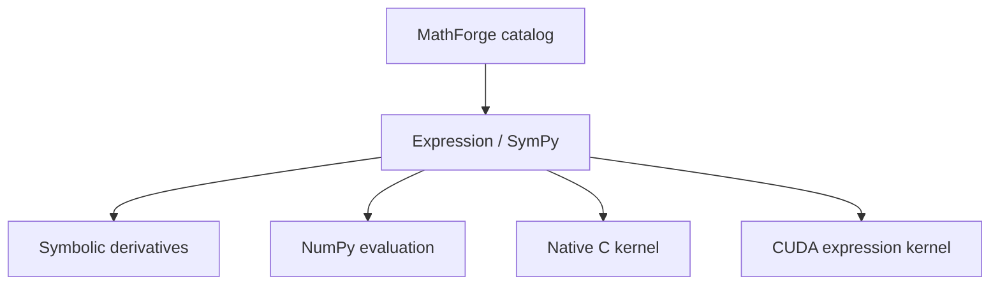
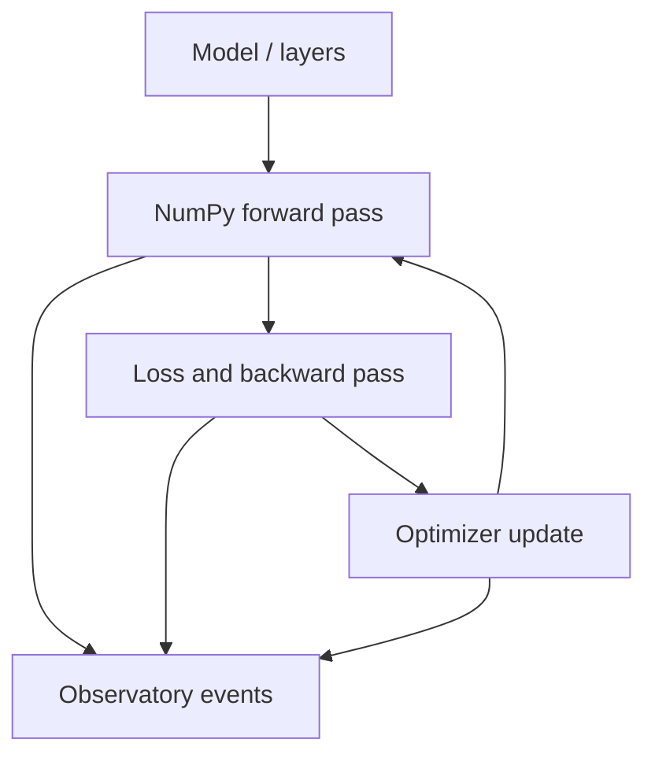

# How NeuroGebra works

NeuroGebra has several computation paths. They serve different purposes and share NumPy/SymPy building blocks rather than one universal backend.

## Expression execution

`MathForge.get()` returns an expression with its own parameter dictionary. `Expression` retains the SymPy graph, exposes symbolic differentiation and LaTeX, and builds a numerical callable for evaluation. The native backends compile supported formulas into standalone elementwise kernels.

## Neural training

`ModelBuilder` creates `Model`/`Layer` objects. Layers initialize parameters from input shapes, cache forward values and implement NumPy backward passes. The educational and Observatory training loops use these real computations. The final Dense softmax/cross-entropy pair uses stable logits for its loss and a fused gradient.

The separate `Value`/`Tensor` engine records eager operation graphs for reverse-mode differentiation. `Trainer` fits scalar-parameter expressions with symbolic derivatives, with finite differences as a fallback. `PINN` fits data and equation residuals using numerical coordinate/residual derivatives.

## Module map

| Module | Responsibility | Guide |
|---|---|---|
| `core` | Expressions, formula access, eager autograd, expression training, NeuroCraft | [Core API](../api/core.md) |
| `repository` | Ten domains of symbolic formula definitions and search | [Formula catalog](../reference/formulas.md) |
| `builders` | Layers, sequential model construction, training and checkpointing | [Builders API](../api/builders.md) |
| `training` | Educational training display and epoch loop | [Logging and training API](../api/logging.md) |
| `optim` | Optimizers and learning-rate schedules | [Optimization guide](../advanced/optimization.md) |
| `metrics` | Batch classification and regression evaluation | [Metrics guide](../science/metrics.md) |
| `acceleration` | Native C and CUDA expression compilation | [Backend guide](../science/acceleration.md) |
| `science` | Educational PINN solver and residual helpers | [PINN guide](../science/pinn.md) |
| `datasets` | Offline generators and optional scikit-learn loaders | [Dataset catalog](../reference/datasets.md) |
| `logging` | Events, diagnostics, storage, dashboards and exports | [Observatory](../tutorial/training-observatory.md) |
| `bridges` | Expression adapters and supported model conversions | [Bridge guide](../advanced/framework-bridges.md) |
| `viz`, `utils`, `tutorials` | Plotting, explanation helpers and interactive learning | [API index](../api/reference.md) |

## Performance boundary

Compiling an expression with `backend="cuda"` changes how that expression is evaluated. It does not convert `Model` layers, the autograd engine or PINN training into GPU operations. See [capabilities and limits](../project/capabilities.md) before comparing performance with another framework.
